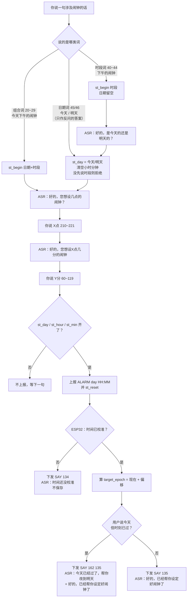
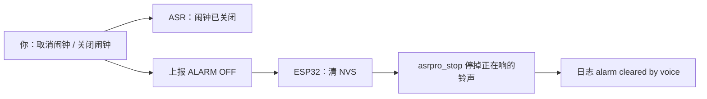
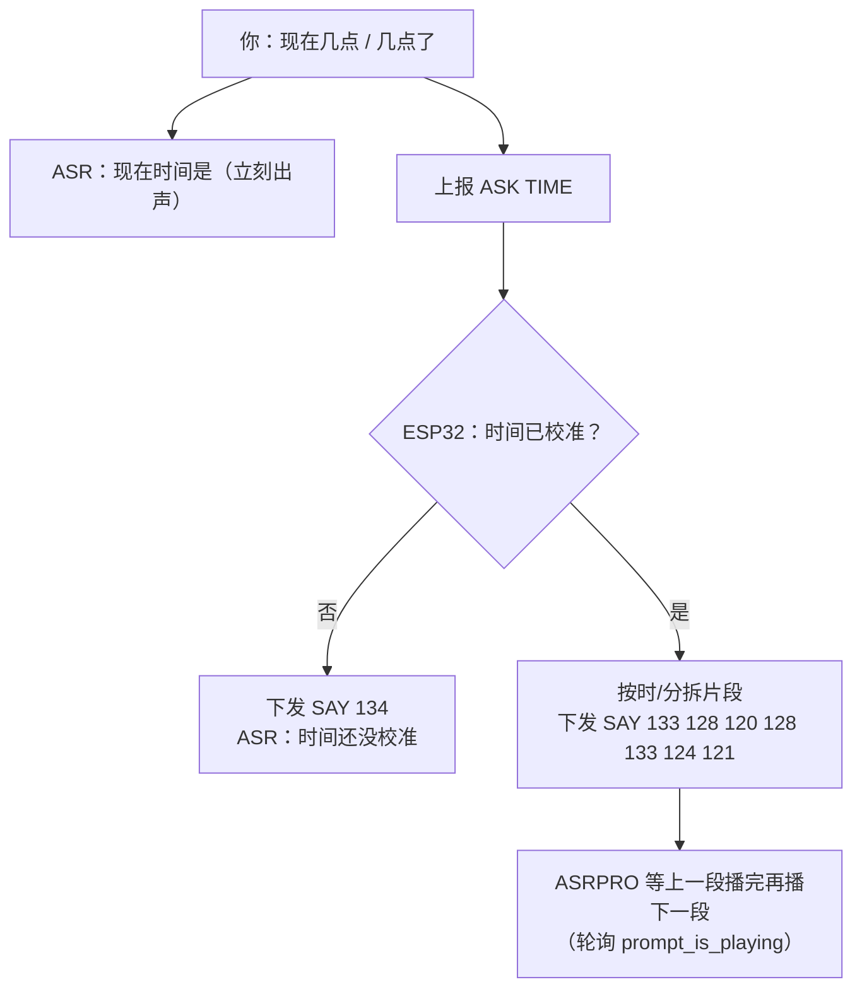
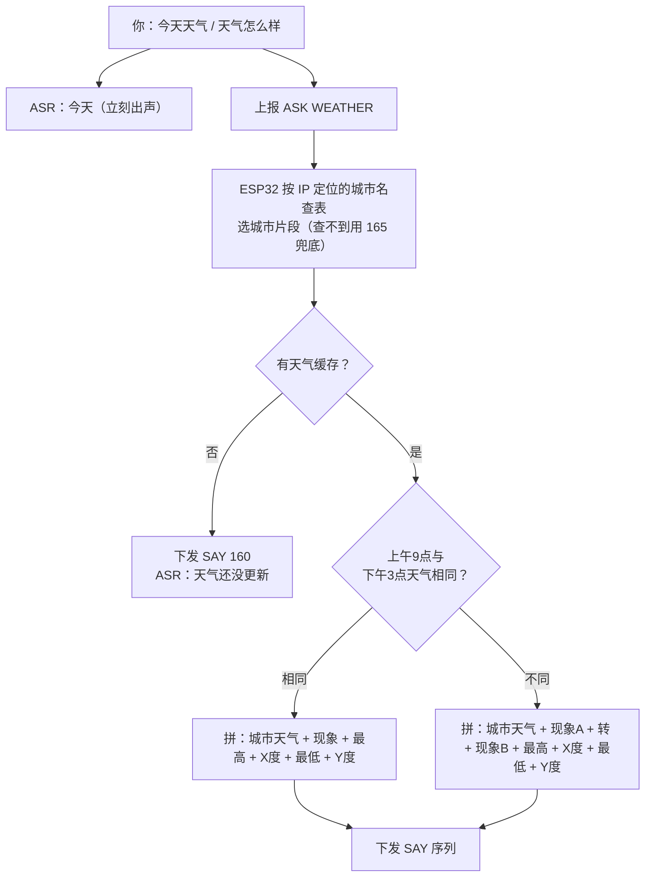
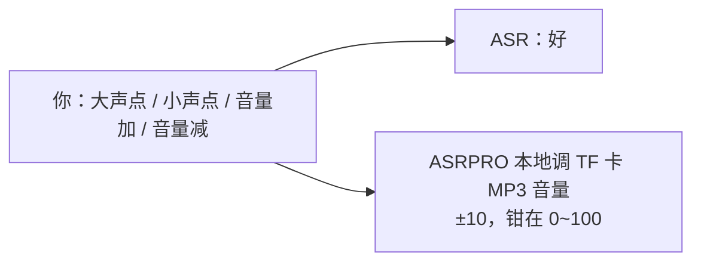

# 语音对话流程设计（ASRPRO 词表 + ESP32 逻辑）

## 目标

把"能听能说"这一层完整固定下来：谁负责哪一段、说了什么会触发什么、异常情况回哪句。
后续加功能时按本文扩充，避免出现"某条路径没人管"的漏网分支。

## 一、角色分工

| 角色 | 负责 | 不掌握 |
|---|---|---|
| **ASRPRO** | 语音识别、词表、播放提示音与片段、闹钟拼装状态机 | 真实时间、日期、天气、网络 |
| **ESP32** | 校时、时区、闹钟时间戳计算与 NVS 存储、天气抓取、**决定该播哪句** | 不做语音识别；不能直接出声 |

三条硬约束（决定了下面所有设计）：

1. **ASRPRO 没有 TTS** —— 能播的只有"词表里预先合成好的固定音频"，动态内容必须靠**片段拼接**。
2. **一次只识别一个命令词** —— 所以"日期 / 时段 / 小时 / 分钟"必须拆成多轮问，不能一句话说全。
3. **半双工** —— 播提示音期间麦克风静音，用户抢话会被丢掉；要等提示音说完再答。

### 为什么必须多轮

命令词是**整句精确匹配**，不做语义拆分。要让"今天下午八点十五分"一句话可识别，
就得把 `8 种日期时段 × 12 小时 × 60 分 = 5760 条`全部写进词表（官方上限 300 条）。

拆成多轮后，组合数从**相乘变相加**：`8 + 12 + 60 = 80 条`，便宜 72 倍。

## 二、串口协议（115200，按行分隔）

### ASRPRO → ESP32

| 上报 | 含义 | 触发点 |
|---|---|---|
| `ASK TIME` | 请求播报当前时间 | 命令词 30 / 31 |
| `ASK WEATHER` | 请求播报今天天气 | 命令词 32 / 33 |
| `ALARM <0\|1> HH:MM` | 设置**一次性**闹钟。0=今天 1=明天，HH:MM 为换算后的 24 小时值 | 闹钟要素凑齐 |
| `ALARM OFF` | 取消闹钟并停铃 | 命令词 242 / 243 |

### ESP32 → ASRPRO

| 下发 | 含义 |
|---|---|
| `SAY <id> <id> ...` | 依次播放这些命令词的**回复音**（片段），最多 14 段 |

### 为什么确认句要由 ESP32 下发

"该说哪句"取决于 ESP32 才知道的状态（时间是否已校准、是否顺延到明天）：

| 下发 | 场景 |
|---|---|
| `SAY 135` | 正常存好 |
| `SAY 134` | 时间还没校准，**拒绝保存** |
| `SAY 162 135` | 今天那个时刻已过，顺延到明天（先说明再确认） |

ASRPRO 侧因此**不再自动播确认句** —— 它只负责上报。

## 三、闹钟拼装状态机（ASRPRO 侧）

| 变量 | 取值 |
|---|---|
| `st_day` | -1 未定 / 0 今天 / 1 明天 |
| `st_period` | -1 未说 / 0 凌晨 / 1 上午 / 2 下午 / 3 晚上 |
| `st_hour` | -1 未定 / 1~12 |
| `st_min` | -1 未定 / 0~59 |

- **上报门槛**：`st_day >= 0 && st_hour >= 0 && st_min >= 0` —— **时段必须先说**，日期可以后补。
- **上报后立即 `st_reset()`**，方便紧接着再设一个。
- 日期词会清空 `st_hour/st_min`，防止上一次没设完的残留被误判成"已凑齐"。

### 时段换算（12 小时制 → 24 小时制）

| 时段 | 换算 |
|---|---|
| 上午（1） | 原样 |
| 下午（2） | 12 点 = 12:00；其余 +12 |
| 晚上（3） | 12 点 = 00:00；其余 +12 |
| 凌晨（0） | 12 点 = 00:00；其余原样 |

日期词只用于回答反问，不能单独开场；没先说时段就说"今天/明天"会被拒绝
（否则接下来那个"八点"是上午还是下午无从判断）。

## 四、流程

### 4.1 唤醒


### 4.2 设置闹钟（三条路径都通向同一处）



### 4.3 闹钟的两种说法 + 一种被拒绝（实例）

**路径 A：不说日期（ASR 反问）**

```
你：下午的闹钟
ASR：好的，是今天的还是明天的？
你：今天
ASR：好的，您想设几点的闹钟？
你：八点
ASR：好的，您想设八点几分的闹钟
你：十五分
ASR：好的，已经帮你设定好闹钟了
```

**路径 B：一次说全（少一轮）**

```
你：今天下午的闹钟
ASR：好的，您想设几点的闹钟？
你：八点
ASR：好的，您想设八点几分的闹钟
你：十五分
ASR：好的，已经帮你设定好闹钟了
```

**路径 C：只说日期 —— 会被拒绝**

```
你：今天
ASR：请先说是上午还是下午的闹钟      ← 被拒绝

你：今天下午的闹钟                    ← 正确的开场
ASR：好的，您想设几点的闹钟？
```

为什么不允许：日期词只用于回答反问。如果放任"今天"开场，接下来那个"八点"
到底是上午还是下午无从判断。**时段必须先说。**

### 4.4 取消闹钟



## 4.5 当前时间



播报示例：**现在时间是十五点十五分**

## 4.6 今天天气



播报示例：**今天杭州天气晴间多云转多云，最高二十五度，最低十六度**

天气缓存在**每次校时成功后**顺手抓一次（开机 + 每天 3:00），不做按需联网。
原因是按需联网要等 3~5 秒，而天气预报本身是当天粒度的。

## 4.7 音量



注意：目前只调**TF 卡那一路**（`lxb_mp3_Serial1.volume`），ASRPRO 自己播报音的音量（1~7 档）**还没联动**。

## 五、播报片段 ID 对照表

片段是一批命令词，它们的 **ASRTO 就是音频内容**；ASR 故意写成"播报音XX"这类不会误触发的说法。

| ID | 内容 | 用途 |
|---|---|---|
| 120 | 点 | 时间 |
| 121 | 分 | 时间 |
| 122 | 整 | 时间（整点不说"零分"） |
| 123~132 | 零 一 二 三 四 五 六 七 八 九 | 数字 |
| 133 | 十 | 数字（0~99 靠这 11 段拼） |
| 134 | 时间还没校准 | 时间；闹钟被拒绝 |
| 135 | 好的，已经帮你设定好闹钟了 | 闹钟确认 |
| 136~155 | 晴/晴间多云/多云/阴/有雾/毛毛雨/冻雨/小雨/中雨/大雨/暴雨/阵雨/中阵雨/阵雪/强阵雪/小雪/中雪/大雪/雷阵雨/雷阵雨伴冰雹 | 天气现象（20 种） |
| 156 / 157 | 最高 / 最低 | 天气 |
| 158 | 度 | 天气 |
| 159 | 零下 | 天气（负温度） |
| 160 | 天气还没更新 | 天气无缓存 |
| 161 | 转 | 晴转多云 |
| 162 | 今天已经过了，帮你改到明天 | 闹钟顺延提示 |
| 163 | 好的，您想设几点的闹钟？ | 日期反问后的引导语 |
| 164 | 请先说是上午还是下午的闹钟 | 只说日期时被拒绝的提示 |
| 165 | 天气 | IP 没匹配到城市时的兜底 |
| 166~249 | 〈城市〉天气 —— 预置 70 个城市 | 由 IP 定位结果选中哪个 |

### 数字拼接规则

`n < 10` → 数字；`10 ≤ n < 20` → 「十」[+数字]；`n ≥ 20` → 十位数字 + 「十」[+个位数字]。
**分钟不足 10 要补「零」**：15:05 说"十五点**零**五分"，不能说成"十五点五分"。

## 六、识别词 ID 全表

| ID | 内容 | 回复 / 动作 |
|---|---|---|
| 0 | 小爱同学（唤醒词） | 我在 |
| 1 | 播放音乐 | 好的 |
| 20~29 | 今天/明天 × 早上/上午/下午/晚上/凌晨 的闹钟 | 好的，您想设几点的闹钟？ |
| 30 / 31 | 现在几点 / 几点了 | → `ASK TIME` |
| 32 / 33 | 今天天气 / 天气怎么样 | → `ASK WEATHER` |
| 40~44 | 早/上午/下午/晚上/凌晨 的闹钟 | 好的，是今天的还是明天的？ |
| 45 / 46 | 今天 / 明天 | 留空（只作反问的答案，引导语由代码播） |
| 60~119 | 整点 + 一分~五十九分（60 条） | **留空**（不抢话，等确认句） |
| 120~164 | 播报片段（见上表） | 片段音频本身 |
| 165~249 | 城市名片段（70 个城市 + 兜底） | 内容为「〈城市〉天气」 |
| 210~221 | 一点~十二点 | 好的，您想设X点几分的闹钟 |
| 242 / 243 | 关闭闹钟 / 取消闹钟 | 闹钟已关闭 / → `ALARM OFF` |
| 250~253 | 大声点/小声点/音量加/音量减 | 好 |

**共 217 条**，上限 300 条，余量约 83 条（还能再加约 80 个城市）。

## 七、异常与边界

| 情况 | 行为 |
|---|---|
| 从未校时过就设闹钟 | **拒绝保存**，回「时间还没校准」 |
| 开场只说日期、没说时段 | 拒绝，并提示「请先说是上午还是下午的闹钟」 |
| 「今天」+ 已经过去的时刻 | 顺延到明天，并明确播报改期 |
| 设了闹钟后断电多日再上电 | 过期超过 5 分钟**静默丢弃**，不补响（日志 `stale alarm dropped`） |
| 断网但当天已校过时 | 闹钟照响（内部 RTC 继续走时，有漂移） |
| 闹钟响的瞬间断网 | 照响（TF 卡本地音频，不走网络） |
| 断网时问天气 | 「天气还没更新」 |
| 断网时问时间 | 「时间还没校准」 |
| 校时失败 | 60 秒一次、有限次自动重试 |
| 闹钟只响一次 | 响完立即清 NVS，不重复 |
| 播报期间用户抢话 | 会被丢失（半双工），需等提示音说完 |

## 八、已知限制

1. **城市靠预置名单，不是任意城市** —— ASRPRO 无 TTS，城市音频必须提前合成，所以预置了 70 个城市片段（165~249）。IP 匹配不到时退化成只说「天气」。加城市要加词 + 重新生成模型；加**别名**只需重烧 ESP32（对照表在 `time_service.c` 的 `k_city_fragments`）。
2. **「今天」与「今天天气」可能互相干扰** —— 离线整句匹配的行为需要实测；若"今天天气"误走闹钟日期分支，日期词需改成带后缀的形式。
3. **音量未双通道联动** —— ASRPRO 播报音（1~7 档）不受"大声点"影响。
4. **天气不持久化** —— 重启后到开机校时之间无缓存，会答"天气还没更新"。
5. **不支持每日重复闹钟** —— 当前是纯粹的一次性语义。
